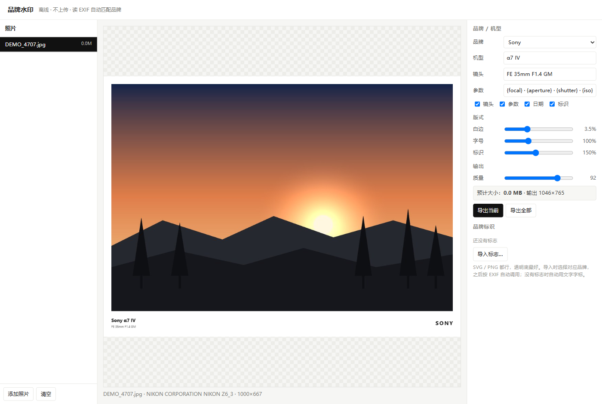

# Eazy Watermarker

Offline tool that adds a white border plus a typographic credit block (camera body · lens · exposure) and a brand mark to your photos. It reads EXIF, figures out the brand and model, and renders everything locally — nothing is uploaded.




- **Fully offline** — no network, no upload
- **Three forms**: Windows `.exe`, a single-file offline web page, and a batch CLI
- **Auto detection**: EXIF → brand → normalized model name (`NIKON Z6_3` → `Z6III`, `ILCE-7CM2` → `α7C II`)
- **Pluggable logos**: drop SVG/PNG files into `logos/`; falls back to a text wordmark when missing
- **Controllable output**: border / type size / mark size sliders, JPEG quality 60–100 with size estimate

---

## Quick start

### Desktop (recommended)

```bash
pip install -r requirements.txt
python src/gui.py
```

Build a standalone exe on Windows:

```bat
build.bat
```

Output: `dist/EazyWatermarker.exe`.

### Web (single offline file)

```bash
python src/make_web.py
```

Open `build/web/index.html` in Chrome/Edge. Logos present in `logos/` are embedded into the HTML at build time, so add them first if you want official marks.

### CLI

```bash
python src/cli.py photos -o out
python src/cli.py a.jpg -o out --quality 90 --border 4
python src/cli.py photos --brand sony --model "α7 IV" --seal 130
```

---

## Brand logos

**No brand logos are bundled** — they are trademarks owned by their respective companies.

Drop your own files into `logos/`:

```
logos/
  nikon-seal.svg        full color mark (kept as-is)
  sony-wordmark.svg     wordmark (keyed to transparent, recolored to near-black)
  canon-logo.svg        alias of wordmark
```

Lookup order: `<brand>-seal.*` → `<brand>-wordmark.*` → `<brand>-logo.*` → `<brand>.*`

Brand keys: `nikon` `sony` `canon` `fujifilm` `panasonic` `om` `leica` `pentax`
`ricoh` `hasselblad` `dji` `sigma` `apple` `google`

Without a matching file the tool draws a text wordmark instead, so it works out of the box.

Logos can be obtained from each vendor's press/brand page or [Wikimedia Commons](https://commons.wikimedia.org/). Check trademark rules before commercial use.

Or let the helper fetch them (optional):

```bash
python src/fetch_logos.py --list                    # what's available
python src/fetch_logos.py --all                     # Wikimedia originals
python src/fetch_logos.py --all --source jsdelivr   # Simple Icons (works in mainland China)
```

The script validates that the response is a real SVG before writing, so 404 pages or empty files never land in `logos/`.

Without any logo file the tool draws a text wordmark instead — the layout is identical.

---

## Options

| Option | Default | Notes |
|---|---|---|
| border | 3.5% | percentage of the short edge |
| type size | 100% | scales the whole text block |
| mark size | 150% | mark height = text block height × 1.5 |
| quality | 92 | JPEG quality |

Template placeholders: `{focal}` `{aperture}` `{shutter}` `{iso}` `{make}` `{lens}`

Size estimate encodes a center crop at the chosen quality and extrapolates by area (±20%).

## Layout

```
src/
  core.py            EXIF, model normalization, layout, logo handling, size estimate
  gui.py             tkinter desktop UI
  cli.py             batch CLI
  make_web.py        builds the single-file HTML
  fetch_logos.py     optional: fetch brand marks into logos/
  web_template.html  web UI template
docs/                screenshots and a synthetic demo image
logos/               your brand marks (git-ignored)
```

## Author

- **Author**: `AshClear` (GitHub [@AshClear](https://github.com/AshClear))
- **Issues**: please open one [here](https://github.com/AshClear/Eazy-Watermarker/issues)

## License

MIT for the code. Brand logos and trademarks belong to their owners and are not included.
